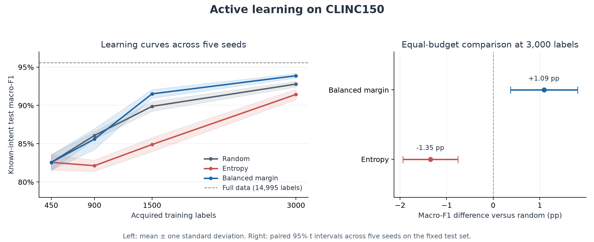

# Active Learning for Intent Classification

A reproducible experiment on label selection for a 150-intent assistant, with a local prediction API and an out-of-scope rejection gate. The project compares random acquisition, predictive entropy, and margin sampling balanced across predicted classes on [CLINC150](https://github.com/clinc/oos-eval).

The goal is to measure whether a selection policy improves classification at the same training-label budget. This is an offline annotation simulation using existing benchmark labels, not a measurement of actual human labeling costs.

## Measured results

At **3,000 acquired training labels**, averaged across **five seeds**:

| Acquisition policy | Mean test macro-F1 | SD across seeds |
|---|---:|---:|
| Random | 0.9278 | 0.0037 |
| Predictive entropy | 0.9143 | 0.0067 |
| **Balanced margin** | **0.9387** | **0.0030** |

Balanced margin improved macro-F1 by **1.09 percentage points** over random acquisition. The paired 95% interval across five seeds was **+0.37 to +1.81 percentage points** on the fixed test set. Entropy acquisition performed worse than random in this experiment; that result is retained in the reports.

The selected seed-42 deployment model rejected **79.5% of 1,000 out-of-scope utterances** while accepting **95.5% of 4,500 known-intent utterances**. Its known-intent macro-F1 was 0.9430 before rejection.



See [RESULTS.md](RESULTS.md), [complete metrics](artifacts/metrics.json), [every seed and budget](artifacts/learning_curves.csv), and the [protocol recorded before evaluation](EXPERIMENT_SPEC.md).

## What the experiment controls

- The original data has 15,000 training utterances. Five exact normalized overlaps with evaluation data are removed, leaving **14,995** training candidates.
- Official evaluation rows are preserved: **3,000 known validation**, **4,500 known test**, and **1,000 out-of-scope test** utterances.
- Three acquisition policies are compared at **450, 900, 1,500, and 3,000 training-label budgets**, with seeds **42–46**: **60 fitted budget models** plus one full-data reference.
- Within a seed, every policy starts with the same 450 examples: three per intent. This idealized starter set uses benchmark oracle labels to balance classes.
- Acquisition functions receive pool predictions and indices, not hidden labels. Labels become accessible only after selection.
- The representation is a frozen, pinned MiniLM encoder. Every policy uses the same multinomial logistic-regression head configuration.
- The deployment policy is chosen by mean **validation macro-F1** at 3,000 labels. The deployment seed is fixed at 42. All trajectories and selections are frozen before test learning curves are calculated.

The 3,000-label budget excludes the separate **3,000 labeled validation examples**. No 80% reduction in total annotation cost, novel algorithm, or state-of-the-art result is claimed. The full-data reference obtains 0.9557 macro-F1 using 14,995 training labels.

## Methods

1. **Random:** sample uniformly from the remaining pool.
2. **Entropy:** select the largest Shannon entropy of the classifier's intent probabilities.
3. **Balanced margin:** sort by the gap between the two highest intent probabilities, then acquire in round-robin order across predicted classes. This reduces batch domination by a few predicted intents. It uses predictions, not oracle class labels.

For representation, `sentence-transformers/all-MiniLM-L6-v2` runs through ONNX Runtime with attention-masked mean pooling and normalized 384-dimensional vectors. The encoder is reused without fine-tuning. A logistic-regression head is trained from scratch for each budget.

For rejection, the fifth percentile of known validation maximum probabilities defines a confidence gate. Queries below this threshold are returned as `out_of_scope`. This is a heuristic with measured tradeoffs, not a conformal or out-of-distribution coverage guarantee. The observed unknown false-acceptance rate was 20.5%.

## Quick start

Use **Python 3.12**, the tested version.

```bash
git clone https://github.com/WhiteDevil377/active-learning-intent-classification.git
cd active-learning-intent-classification
python3 -m venv .venv
source .venv/bin/activate
python -m pip install -r requirements.txt
python prepare.py
python experiment.py
python write_report.py
python verify.py
```

On Windows, activate with `.venv\Scripts\activate`. Preparation downloads the pinned dataset and approximately 90 MB of pretrained model weights, checks overlap, and caches embeddings. The experiment trains all policies and writes reports and the selected classifier. Data, model weights, embeddings, and classifier binaries are excluded from Git.

### Command-line prediction

```bash
python predict.py "what is my account balance"
```

### Local JSON API

```bash
python serve.py --port 8766
curl http://127.0.0.1:8766/health
curl -X POST http://127.0.0.1:8766/predict \
  -H 'Content-Type: application/json' \
  -d '{"texts": ["what is my account balance"]}'
```

Responses contain the predicted intent, a rejection flag, the confidence gate, and the three highest-scored known intents. Scores are classifier outputs and are not guaranteed to be calibrated probabilities. The API is a local demonstration service.

## Verification and audit files

`verify.py` checks acquisition isolation from hidden labels, entropy behavior, class-balanced batches, reproducible random acquisition, equal starter sets, nested nonrepeating acquisition trajectories, cleaned split separation, classifier classes, rejection decisions, masked pooling, and real API success/error responses.

Audit files include:

- `artifacts/data_quality.json`: removed training rows, label order, split sizes, and source checksum.
- `artifacts/acquisition_indices.json`: selected training indices at every checkpoint.
- `artifacts/frozen_selection.json`: validation-based policy selection and fixed deployment seed.
- `artifacts/learning_curves.csv`: every seed/policy/budget result.
- `artifacts/deployment_test_predictions.csv` and `deployment_oos_test_predictions.csv`: deployment-model predictions.

The local latency report uses 50 sequential validation utterances and includes encoding plus head scoring. It excludes startup and HTTP overhead and is not production throughput evidence.

## Limits and next experiments

The five-seed intervals describe variability from seed selection on one fixed public test set. They do not establish uncertainty over new datasets. The class-balanced starter is idealized, validation labels are additional supervision, and simulated oracle labels do not capture annotator errors or unequal annotation effort. Dataset and model pretraining overlap cannot be ruled out. Unknown-request rejection remains imperfect, and no multilingual, adversarial, or distribution-shift robustness is established.

Useful next experiments include another intent dataset, noisy annotators, unequal annotation costs, a non-oracle starter, other acquisition policies, or a separately calibrated rejection model.

## Sources and attribution

- Larson et al. (2019), [An Evaluation Dataset for Intent Classification and Out-of-Scope Prediction](https://aclanthology.org/D19-1131/).
- [Original CLINC150 data](https://github.com/clinc/oos-eval) and [dataset card identifying CC BY 3.0](https://huggingface.co/datasets/clinc/clinc_oos).
- [MiniLM model card and pooling instructions](https://huggingface.co/sentence-transformers/all-MiniLM-L6-v2), Apache 2.0.
- [Active learning with sampling by uncertainty and density](https://aclanthology.org/C08-1143/), an established research direction; this prototype does not reproduce that paper's algorithm.

Source data and derived reports retain the dataset's [CC BY 3.0 attribution](https://creativecommons.org/licenses/by/3.0/). Pretrained weights and third-party libraries retain their respective licenses. Dataset and encoder revisions are pinned in JSON files.

This prototype was developed with AI assistance. It demonstrates the recorded implementation and offline experiment, with the limitations stated above.
