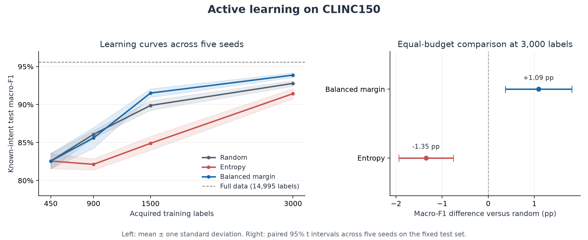

# Measured active-learning results

Generated on 9 November 2026 from the bundled implementation. Results describe an offline simulation on a fixed public benchmark.

Training pool: 14,995 records after removing 5 normalized train/evaluation overlaps. Classes: 150. Validation: 3,000 known-intent examples. Test: 4,500 known-intent and 1,000 unknown examples.

## Complete equal-budget results

| Strategy | Training labels | Mean test macro-F1 | SD across seeds | Mean test accuracy |
|---|---:|---:|---:|---:|
| Random | 450 | 0.8257 | 0.0101 | 0.8309 |
| Random | 900 | 0.8608 | 0.0050 | 0.8648 |
| Random | 1,500 | 0.8988 | 0.0064 | 0.9004 |
| Random | 3,000 | 0.9278 | 0.0037 | 0.9285 |
| Entropy | 450 | 0.8257 | 0.0101 | 0.8309 |
| Entropy | 900 | 0.8213 | 0.0073 | 0.8223 |
| Entropy | 1,500 | 0.8489 | 0.0091 | 0.8512 |
| Entropy | 3,000 | 0.9143 | 0.0067 | 0.9150 |
| Balanced margin | 450 | 0.8257 | 0.0101 | 0.8309 |
| Balanced margin | 900 | 0.8561 | 0.0137 | 0.8583 |
| Balanced margin | 1,500 | 0.9151 | 0.0056 | 0.9159 |
| Balanced margin | 3,000 | 0.9387 | 0.0030 | 0.9389 |

Selected policy: **balanced_margin**, by mean validation macro-F1 at 3,000 labels. Deployment seed was fixed at 42. All trajectories and this choice were frozen before test learning-curve metrics were calculated.

## Paired differences versus random at 3,000 labels

| Strategy | Mean difference in percentage points | 95% interval across seeds |
|---|---:|---|
| Entropy | -1.35 | [-1.94, -0.76] |
| Balanced margin | +1.09 | [+0.37, +1.81] |

These intervals quantify paired seed variability on this one fixed test set. They do not establish performance on new datasets. The entropy result is retained even though it is worse than random.

Full-data reference (14,995 training labels): macro-F1 **0.9557**, accuracy **0.9558**.

The budget comparison excludes the separate 3,000 labeled validation examples. Each strategy begins from an oracle-assisted, class-balanced 450-label seed set. No actual human annotation costs, time savings, or production outcomes were measured.

## Deployment model and rejection gate

Seed-42 deployment model known-intent macro-F1: **0.9430**. The gate threshold is the fifth percentile of maximum probabilities on known validation examples, not a formal coverage guarantee.

| Gate metric | Value |
|---|---:|
| threshold | 0.2792 |
| known_acceptance_rate | 0.9547 |
| unknown_rejection_rate | 0.7950 |
| unknown_false_acceptance_rate | 0.2050 |
| unknown_detection_roc_auc | 0.9593 |
| accepted_known_accuracy | 0.9618 |

## Local timing

50 sequential validation queries: median **2.22 ms**, p95 **3.24 ms**. Includes encoding and classifier scoring; excludes loading, startup, and HTTP overhead. Machine-dependent, single-process measurements are not production throughput evidence.

## Reproducibility

Dataset SHA-256: `36923c3705a59e08fe9c3883d8bc2dd966ef93e22cb78ac41171782a698d56e0`.

See `EXPERIMENT_SPEC.md`, `artifacts/learning_curves.csv`, `artifacts/acquisition_indices.json`, and the pinned dataset/model revisions for full protocol and audit details.

## Attribution

CLINC150: Larson et al. (2019), https://aclanthology.org/D19-1131/. Dataset: https://github.com/clinc/oos-eval, identified as CC BY 3.0 by https://huggingface.co/datasets/clinc/clinc_oos. Encoder: https://huggingface.co/sentence-transformers/all-MiniLM-L6-v2, Apache 2.0.
